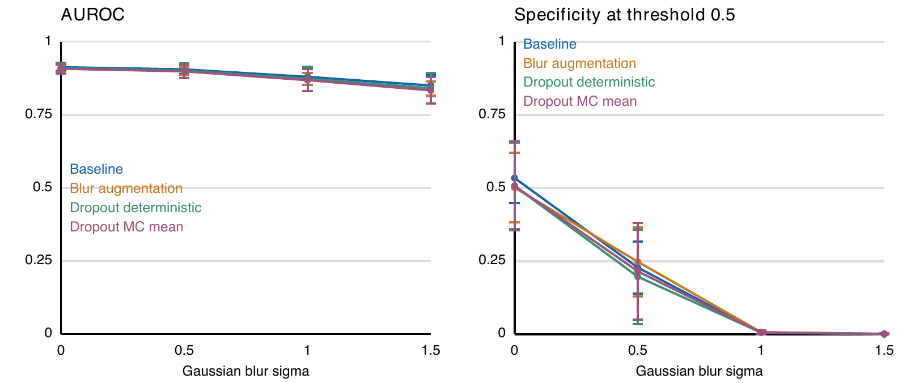
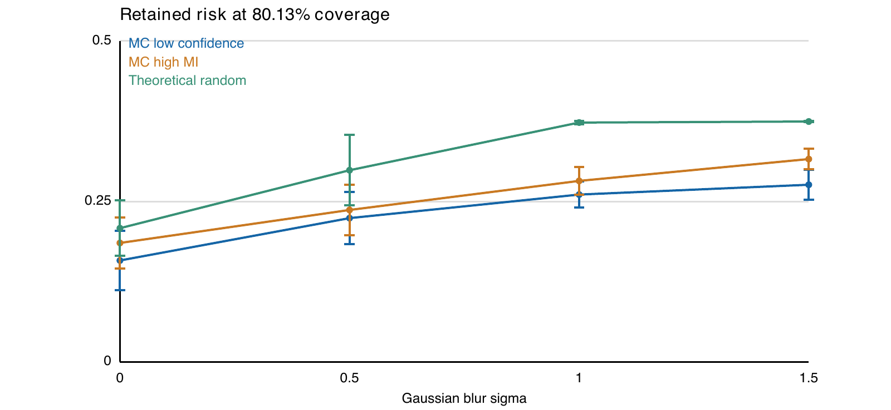

# Pneumonia classification under controlled blur

A research benchmark comparing confidence and MC Dropout mutual information for selecting pneumonia-classification errors for review.

## Research questions
1. How does Gaussian blur change classification ranking and class-specific errors?
2. For identical MC predictions, does low-confidence or high-MI selection retain fewer errors at the same review budget?

PneumoniaMNIST official partitions; 28 × 28 grayscale inputs; compact 4,866-parameter CNN; baseline, blur augmentation, and Dropout variants; three training seeds (42–44); ten epochs per run. The protocol was frozen after exploratory validation, before final test evaluation, not preregistered at study start.

## Results



Under sigma=1.5 blur, baseline mean AUROC remains 0.8504 while specificity reaches zero. With 124/624 test images referred and 500 retained, MC low-confidence selection has mean retained risk 0.2760 versus 0.3160 for high MI, a paired difference of 4.00 percentage points. The direction holds across all three seeds and four tested blur conditions. Error bars are sample SD across seeds on the same test images, not population confidence intervals. No significance or clinical-safety claim is made.

## Files
- `code/`: historical repeat-training and final-evaluation implementations. Original Colab absolute paths require root-path adjustment. Do not rerun final tests to tune settings.
- `results_summary/`: saved aggregate test results, not newly generated predictions.
- `lectrace/`: five selected execution states, short speaker cues, real seed42 checkpoint and validation-demo assets.
- `figures/`: vector versions of report figures.

The nine-checkpoint experiment archive and complete original notebook remain in the course submission package; this repository is a curated public companion. Personal cover page, student ID, graded assignments, private course slides and raw dataset are excluded. This repository does not by itself recreate every historical run.

## Run the LecTrace demonstration
```bash
python -m venv .venv
source .venv/bin/activate
pip install -r lectrace/requirements.txt
cd lectrace
lectrace build 01_pneumonia.py
python -m http.server 8769 --directory _site
```
Open http://127.0.0.1:8769 . The demo downloads the official validation dataset and uses eight fixed examples. It does not train or evaluate the test split. Demonstration inference uses its documented environment, different from the historical training environment; exact cross-version MC masks are not guaranteed. Two of eight demonstration images are referred (25%), distinct from the main test budget (124/624).

## Attribution and scope
AI assisted problem formulation, implementation, debugging, analysis, writing and LecTrace preparation; generated work was checked against saved artifacts. The study is a course research project, not a diagnostic product. Artificial blur is not equivalent to hospital distribution shift, and human-review accuracy was not measured.

- Dataset: [MedMNIST](https://medmnist.com/), Yang et al., Scientific Data 2023, DOI:10.1038/s41597-022-01721-8.
- Image-source study: Kermany et al., Cell 2018, DOI:10.1016/j.cell.2018.02.010.
- MC Dropout: Gal and Ghahramani, ICML 2016, https://proceedings.mlr.press/v48/gal16.html .
- Confidence baseline: Hendrycks and Gimpel, ICLR 2017, https://arxiv.org/abs/1610.02136 .
- LecTrace authoring pattern: [official demo](https://github.com/praisegee/lectrace-demo).
- Conceptually extends the author's earlier CNN coursework; the current two-class pneumonia architecture, controlled-blur analysis and review comparison are a new study. No other student's implementation is included.

Third-party tools and data retain their respective licenses. No blanket license is granted to third-party material.
